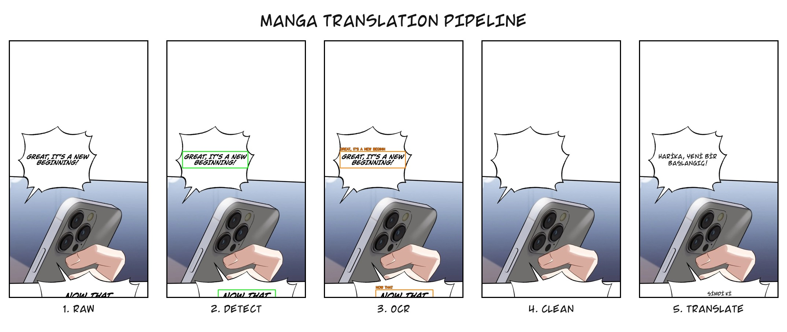
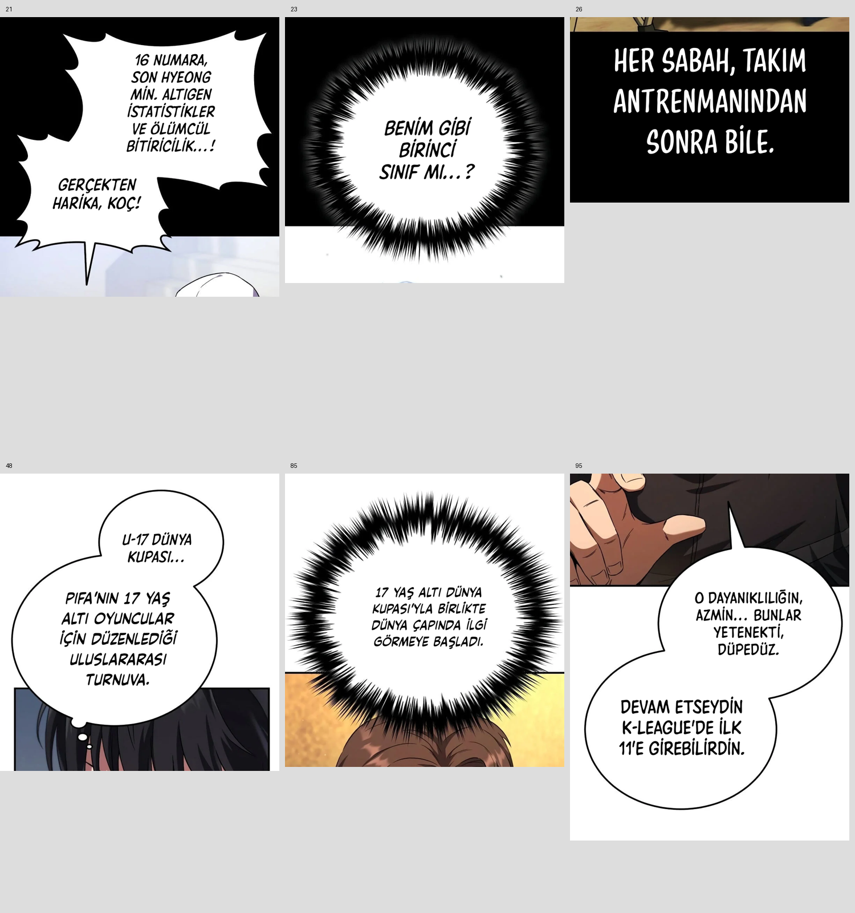

# Manga Translation

**From chapter images to translated, typeset pages — with recovery, visual checks and a publication queue.**

English · [Türkçe](README.tr.md) · [Configuration](.env.example) · [CPU / Docker](CV2-CLEANER.md) · [Worker integration](docs/worker-integration.md)

Manga Translation is the translation worker used in the TrendManga workflow. It detects text and balloons, reads dialogue, translates it, removes source lettering and places the translation back into the artwork. Run it on a local image folder, or connect the queue worker to PostgreSQL and S3-compatible storage.

The current English → Turkish profile uses **API detection + vision OCR + LLM translation + local CV2 cleanup + offscreen Qt typesetting**. The text-mask segmenter still uses model weights; “CV2 cleanup” does not mean the entire system is model-free or offline.

## See the result



The illustration above explains the visual states. Runtime batches can overlap stages; translation precedes cleanup so only text selected for translation is erased.

### Real layout checks



These are real saved chapter pages, reprocessed locally through the production cleaner and renderer on **2026-11-07**. The six examples cover separate writing areas in joined balloons, wider paragraphs in spiky balloons, source-letter cleanup on black and balanced font sizes. They demonstrate the reviewed cases, not a guarantee for every page. This review did not make new OCR requests or publish the chapter.

## What the worker does

| Stage | Behavior |
|---|---|
| Input and safe recut | Read local/R2 images; find cuts outside padded text and balloon regions; verify retained pixels. |
| Detection and OCR | Locate balloons/text through the configured API; require complete crop IDs and original-script metadata. |
| Translation | Translate chapter batches with context, then check missing responses and consistency. |
| Cleanup | Build the initial segmentation mask and fill with CV2. Use proven flat balloon/caption interiors where safe. |
| Typesetting | Match source lettering, fit text inside the balloon, separate joined lobes and check overlap/borders. |
| Save and publish | Write images; in queue mode upload, record pages, verify public URLs and then optionally remove raw sources. |

The current Latin-dialogue profile preserves Korean/CJK sound effects instead of inventing Latin translations. Large suspicious readings outside balloons receive an independent source check. Uncertain or incomplete OCR fails the page rather than silently losing dialogue.

## Recovery and quality

- **Resume completed stages.** Source hashes, relevant code and settings identify checkpoints. Changed code cannot silently reuse an old bad output.
- **Keep the source on failure.** Failed OCR, uploads or inconclusive publication checks retain raw assets.
- **Separate network and CPU work.** `BATCH_OCR_WORKERS`, `BATCH_WORKERS` and `R2_UPLOAD_WORKERS` control different pools.
- **Inspect actual progress.** Per-job logs, heartbeats and stage timings distinguish a live process from useful work.
- **Review the image.** Automated QA flags are diagnostics, not a substitute for checking real chapter pages.

## Costs: what is actually measured?

There is no reliable fixed “price per chapter”. Page height, dialogue density, model, retries, detection windows, source verification and cache hits all change usage.

### A recorded translation run

| Metric | Recorded value |
|---|---:|
| Translation requests | 55 |
| Input tokens | 118,749 |
| Output tokens | 12,216 |
| Cached input tokens reported | 0 |
| Billing mode | Subscription |
| Estimated token charge recorded by the app | $0.00 |

This is a **translation-only usage aggregate**, not the complete chapter bill. Subscription mode deliberately records no per-token API charge. Subscription fees, quotas, gateway fees, detection, OCR, source checks, storage and compute still need separate accounting. The model route in this sample differs from the template's GPT-5.4-mini setting. See the [sanitized measurement snapshot](docs/measurements.json).

### A transparent API calculation

For a direct GPT-5.4-mini API request, the published standard rates checked on **2026-11-07** are $0.75 / million input tokens, $0.075 / million cached input tokens and $4.50 / million output tokens. [Official model pricing](https://developers.openai.com/api/docs/models/gpt-5.4-mini).

```text
translation USD = ((input − cached) × input_rate
                   + cached × cached_rate
                   + output × output_rate) / 1,000,000
```

**Illustration, not a measured chapter:** 10,000 uncached input + 2,000 output tokens would cost **$0.0165 for translation alone** at those rates. Another model or gateway needs its own rates. Detection/OCR/vision calls, retries, R2 requests/storage and hosting are additional; local cleanup has no model API charge but uses your machine.

Configure `OPENAI_USAGE_BILLING_MODE` and explicit price overrides in [.env.example](.env.example). Unknown/custom model routes should not rely on inferred prices. `LOG_OPENAI_USAGE=true` logs translation usage to `openai_usage_events` when a database is configured. `QWEN_GRID_OCR_USAGE_PATH` and `BATCH_TRANSLATE_USAGE_PATH` provide additional usage files; these are diagnostics, not provider invoices or complete billing for every auxiliary request.

## Speed: a recovery example, not a promise

One earlier completed recovery run processed **257 raw images → 169 recut pieces → 167 published images**, verified all 167 public URLs and took **996 seconds (16 min 36 sec)** in the worker. Existing caches were used; this run predates the latest layout fixes. It is neither a cold-start benchmark nor a throughput guarantee for the current code.

Measure your own job:

```powershell
python scripts/job_timing_report.py YOUR_JOB_ID
```

Logs live in `work/job-logs/`, trace summaries in `work/job-timings/`. Parallel/nested stage durations overlap and must not be added as if they were sequential. See [timing documentation](PIPELINE_TIMING.md).

## Run locally

Requirements: **Python 3.12**, API access for the selected detection/OCR/translation route, and model downloads on first use. The supported CPU profile needs no CUDA GPU. PySide6 renders text offscreen; there is no desktop editor to operate.

```powershell
python -m venv .venv
.venv/Scripts/python.exe -m pip install -r requirements.txt
Copy-Item .env.example .env
```

Edit `.env` before running:

- Set `OPENAI_API_KEY` and a vision-capable `OPENAI_MODEL`; use `OPENAI_BASE_URL` for an OpenAI-compatible provider.
- Set `SOURCE_LANG` / `TARGET_LANG`. The reviewed profile is English → Turkish.
- For folder-only use, clear the template's placeholder `DATABASE_URL` and set `LOG_OPENAI_USAGE=false`.
- Keep the CV2/API profile below. Detection, OCR and vision requests send relevant image data to your configured provider.

Put pages in `input/`, then run:

```powershell
.venv/Scripts/python.exe scripts/local_batch.py --input input --output output
```

Read translated images from `output/`. `--output-format png` changes format; `--zip-output` creates an archive. For macOS/Linux, activate the virtual environment, use `cp .env.example .env`, and run the same Python entry point.

### Current template profile

| Setting | Value | Purpose |
|---|---|---|
| `DETECTION_BACKEND` | `api` | Remote region detection; API failure has no silent local fallback. |
| `OCR` | `9Router Vision Grid OCR` | Vision OCR through an OpenAI-compatible endpoint. |
| `OPENAI_MODEL` | `gpt-5.4-mini` | Template model; deployment overrides may choose another model. |
| `CLEAN_ENGINE` / `CLEAN_POSTPROCESS` | `cv2` / `false` | CV2 fill; no neural inpainting or post-clean rescan loop. |
| `BATCH_WORKERS` / `BATCH_WORKERS_AUTO` | `1` / `false` | Bound heavy local work. |
| `BATCH_OCR_WORKERS` / `OCR_CONCURRENCY` | `2` / `2` | Network-bound page pool / OCR request limit. |
| `DETECTION_API_CONCURRENCY` | `4` | Remote detection capacity. |
| `R2_UPLOAD_WORKERS` | `4` | Ordered uploads through a shared client. |
| `PIPELINE_KEEP_CHECKPOINTS` | `true` | Keep recovery files after success. |

Old LaMa/hybrid cleaner settings are unsupported. GPU availability does not turn CV2 fill into neural inpainting. See [the CPU profile](CV2-CLEANER.md) and [all environment settings](.env.example), including fonts, branding, SFX policy and storage.

## Queue worker and deployment

```powershell
.venv/Scripts/python.exe scripts/worker.py
```

Worker mode needs the expected PostgreSQL tables, storage credentials and externally created jobs. The repository does not create your website's database or admin panel. It handles `TRANSLATE_PROJECT`, `TRANSLATE_CHAPTER`, `RETRANSLATE_CHAPTER` and `CLEANUP_RAW_CHAPTER`. See the [database/publication contract](docs/worker-integration.md).

For CPU Docker deployment:

```sh
docker compose --env-file .env.server -f compose.cpu.yml build
docker compose --env-file .env.server -f compose.cpu.yml up -d
```

Preserve secrets and the persistent work volume; let an active chapter finish before deployment. Deployment details and verification limits are in [CV2-CLEANER.md](CV2-CLEANER.md).

## Development and verification

```powershell
.venv/Scripts/python.exe -m unittest discover -s tests
```

The local suite passed **573 tests on 2026-11-07**. That snapshot includes real-image regressions for joined balloons, font sizing, spiky paragraphs and black captions, plus OCR completeness, recovery and upload checks. Local tests do not prove a live provider call or production deployment.

`scripts/review_layout.py` replays saved OCR/translations offline by default. Its `--reocr` mode calls the configured provider; `--blocks-from` uses supplied expected blocks and must not be presented as automated OCR verification. Recovery data is stored in `work/resume/` (recut geometry) and `work/stages/` (processing generations); it can grow substantially.

## License

Code: [Apache-2.0](LICENSE). Model weights, fonts and example artwork may have separate terms.
