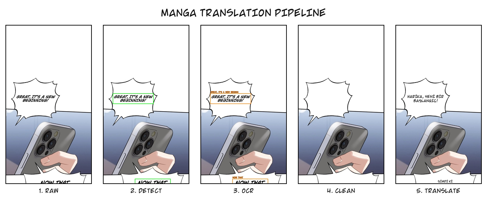
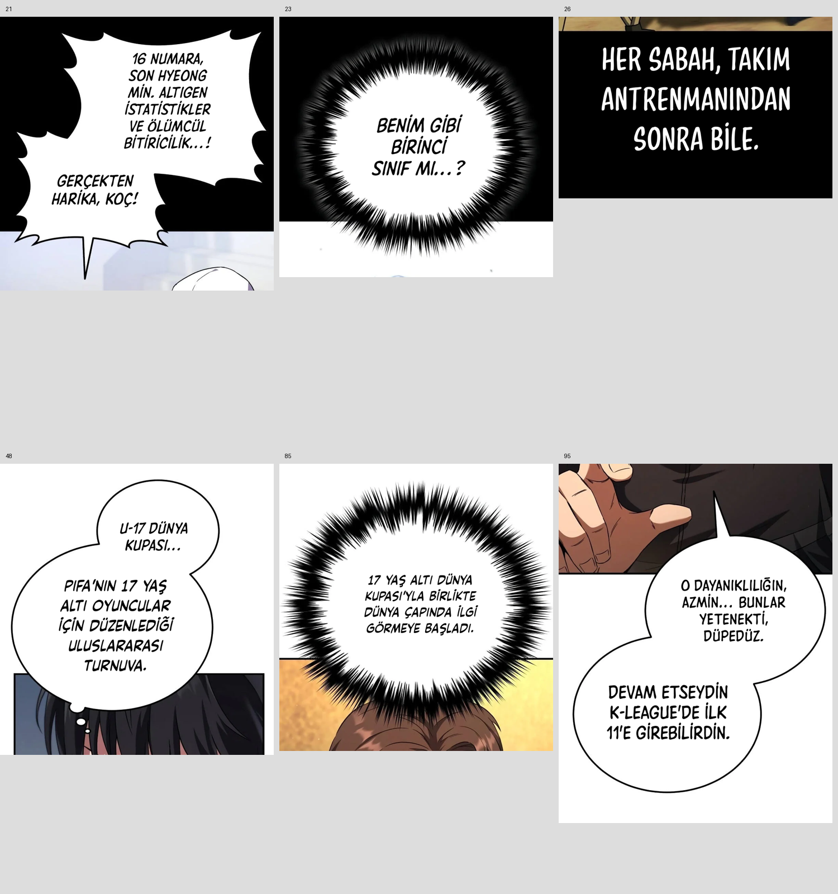

# Manga Translation

**Ham bölüm görsellerinden çevrilmiş, temizlenmiş ve dizilmiş sayfalara — kaldığı yerden devam edebilen bir çeviri workerı.**

[English](README.md) · Türkçe · [Ayarlar](.env.example) · [CPU / Docker](CV2-CLEANER.md) · [Worker entegrasyonu](docs/worker-integration.md)

Manga Translation, TrendManga akışında kullanılan çeviri workerıdır. Sayfadaki metin ve balonları bulur, diyalogları okur, çevirir, kaynak yazıyı temizler ve çeviriyi çizimin içine yeniden yerleştirir. Yerel bir görsel klasöründe çalışabilir; PostgreSQL kuyruğu ve S3 uyumlu depolamayla siteye bağlanabilir.

Güncel İngilizce → Türkçe profili: **API ile tespit + vision OCR + LLM çevirisi + yerel CV2 temizliği + ekransız Qt dizgisi**. İlk metin maskesini çıkaran segmenter hâlâ model kullanır; CV2 temizliği bütün sistemin modelsiz veya çevrimdışı olduğu anlamına gelmez.

## Sonuç nasıl görünüyor?



Yukarıdaki görsel, sayfanın geçirdiği görsel durumları anlatır. Çalışma sırasında aşamalar örtüşebilir; yalnızca çevrilecek metni silmek için çeviri, temizlikten önce tamamlanır.

### Gerçek sayfalarda yerleşim kontrolü



Bunlar **7 Kasım 2026** tarihinde kayıtlı gerçek OCR ve çevirilerle yerel temizleme/render hattından yeniden üretilmiş bölüm sayfalarıdır. Çift balonda ayrı yazı alanı, dikenli balonda geniş paragraf, siyah zeminde eski harf temizliği ve dengeli font boyutlarını gösterir. İncelenen örneklerin sonucudur; her sayfada kusursuzluk garantisi değildir. Bu görsel kontrol yeni OCR isteği göndermedi ve bölümü yayımlamadı.

## Neler yapıyoruz?

| Aşama | Yapılan işlem |
|---|---|
| Girdi ve güvenli kesim | Yerel/R2 görsellerini alır; metin ve balonların koruma alanı dışından keser; korunan pikselleri doğrular. |
| Tespit ve OCR | Yapılandırılan API ile bölgeleri bulur; her kırpımın kimliğini ve özgün yazı sistemi bilgisini kontrol eder. |
| Çeviri | Bölüm bağlamıyla toplu çeviri yapar; eksik yanıtları ve tutarsızlıkları denetler. |
| Temizlik | İlk segmentasyon maskesini çıkarır, CV2 ile doldurur. Kanıtlanmış düz balon/anlatım alanlarını doğrudan temizleyebilir. |
| Yazı yerleşimi | Kaynak stile uygun font seçer; balon sınırını gözetir, çift balonu ayırır, çakışma ve taşmayı kontrol eder. |
| Kaydetme ve yayın | Görselleri kaydeder; kuyruk modunda yükler, sayfa kayıtlarını yazar, herkese açık adresleri doğrular; ardından ham kaynakları isteğe bağlı siler. |

Mevcut Latin diyalog profilinde Korece/CJK ses efektleri uydurma Latin metinlere çevrilmeden korunur. Balon dışındaki büyük, kısa ve şüpheli okumalar bağımsız kaynak kontrolünden geçer. Eksik veya doğrulanamayan OCR, diyaloğu sessizce kaybetmek yerine sayfayı hata durumuna alır.

## Hata sonrası devam ve kalite

- **Tamamlanan aşamadan devam:** Kaynak içeriği, ilgili kod ve ayarlar kayıt kimliğine katılır. Kod değişince eski hatalı çıktı sessizce kullanılmaz.
- **Hata durumunda kaynağı koruma:** OCR/yükleme başarısızsa veya yayın doğrulanamıyorsa ham görseller tutulur.
- **Ağ ve CPU işlerini ayırma:** `BATCH_OCR_WORKERS`, `BATCH_WORKERS` ve `R2_UPLOAD_WORKERS` farklı havuzları yönetir.
- **Gerçek ilerlemeyi izleme:** İş günlükleri, heartbeat ve aşama süreleri, açık bir işlemle ilerleyen bir işi ayırt eder.
- **Görsel kontrol:** Otomatik kalite uyarıları yardımcı tanıdır; gerçek sayfalara bakmanın yerini tutmaz.

## Maliyetler: neyi gerçekten biliyoruz?

Sabit bir “bölüm başı ücret” vermek doğru olmaz. Sayfa yüksekliği, diyalog yoğunluğu, model, yeniden denemeler, tespit pencereleri, kaynak kontrolü ve önbellek kullanımı maliyeti değiştirir.

### Kayıtlı bir bölümün çeviri kullanımı

| Ölçüm | Kaydedilen değer |
|---|---:|
| Çeviri isteği | 55 |
| Giriş tokenı | 118.749 |
| Çıkış tokenı | 12.216 |
| Bildirilen önbellekli giriş tokenı | 0 |
| Faturalama modu | Abonelik |
| Uygulamanın kaydettiği tahmini token ücreti | $0,00 |

Bu tablo **yalnızca çeviri işleminin kullanım toplamıdır**, bölümün tüm faturası değildir. Abonelik modunda token başına API ücreti bilerek sıfır kaydedilir. Abonelik bedeli, kota, aracı servis ücretleri, tespit, OCR, kaynak doğrulama, depolama ve makine giderleri ayrıca değerlendirilir. Bu örnekteki model rotası, şablondaki GPT-5.4-mini ayarından farklıdır. [Hassas bilgilerden arındırılmış ölçüm kaydı](docs/measurements.json).

### Şeffaf API hesabı

Doğrudan GPT-5.4-mini API kullanımı için **7 Kasım 2026** tarihinde kontrol edilen standart liste fiyatları: milyon giriş tokenı başına $0,75; önbellekli giriş için $0,075; çıkış için $4,50. [Resmî model fiyatları](https://developers.openai.com/api/docs/models/gpt-5.4-mini).

```text
çeviri USD = ((giriş − önbellekli) × giriş_fiyatı
              + önbellekli × önbellek_fiyatı
              + çıkış × çıkış_fiyatı) / 1.000.000
```

**Ölçülmüş bölüm değil, hesap örneği:** 10.000 önbelleksiz giriş + 2.000 çıkış tokenı bu fiyatlarla **yalnızca çeviri için $0,0165** eder. Başka model veya aracı servis için kendi fiyatı kullanılmalıdır. Tespit/OCR/vision istekleri, yeniden denemeler, R2 işlem/depolama ve sunucu giderleri buna eklenir. Yerel temizliğin model API ücreti yoktur; makine kaynağı tüketir.

[.env.example](.env.example) içinden `OPENAI_USAGE_BILLING_MODE` ve açık fiyat değerlerini ayarlayın. Özel/bilinmeyen model adlarında otomatik fiyat tahminine güvenmeyin. `LOG_OPENAI_USAGE=true`, veritabanı varsa çeviri kullanımını `openai_usage_events` tablosuna yazar. `QWEN_GRID_OCR_USAGE_PATH` ve `BATCH_TRANSLATE_USAGE_PATH` ek kullanım dosyaları sağlar; bunlar sağlayıcı faturası veya bütün yardımcı çağrıların eksiksiz muhasebesi değildir.

## Hız: bir devam denemesi, genel vaat değil

Daha önce tamamlanan bir devam denemesinde **257 ham görsel → 169 kesilmiş parça → 167 yayımlanan görsel** işlendi, 167 herkese açık görsel adresi doğrulandı ve worker toplamı **996 saniye (16 dakika 36 saniye)** sürdü. Mevcut önbellek kullanıldı; bu çalışma son yerleşim düzeltmelerinden öncedir. Sıfırdan çalışma ölçümü veya güncel kodun hız garantisi değildir.

Kendi işinizi ölçmek için:

```powershell
python scripts/job_timing_report.py IS_KIMLIGI
```

Günlükler `work/job-logs/`, süre özetleri `work/job-timings/` altındadır. Paralel/iç içe aşamaların süreleri örtüşür; ardışıkmış gibi toplanmaz. [Süre ölçümü ayrıntıları](PIPELINE_TIMING.md).

## Yerelde çalıştırma

Gerekenler: **Python 3.12**, seçilen tespit/OCR/çeviri servisine API erişimi ve ilk kullanımda model indirmeleri. Desteklenen CPU profili için CUDA GPU gerekmez. PySide6 yazıyı ekransız render eder; kullanılacak bir masaüstü editörü yoktur.

```powershell
python -m venv .venv
.venv/Scripts/python.exe -m pip install -r requirements.txt
Copy-Item .env.example .env
```

Çalıştırmadan önce `.env` dosyasını düzenleyin:

- `OPENAI_API_KEY` ve görsel okuyabilen bir `OPENAI_MODEL` seçin. OpenAI uyumlu başka sağlayıcı için `OPENAI_BASE_URL` kullanın.
- `SOURCE_LANG` / `TARGET_LANG` değerlerini belirleyin. İncelenen profil İngilizce → Türkçedir.
- Yalnızca klasörde çalışacaksanız şablondaki örnek `DATABASE_URL` değerini boşaltın ve `LOG_OPENAI_USAGE=false` yapın.
- Aşağıdaki CV2/API profilini koruyun. Tespit, OCR ve vision istekleri ilgili görsel verilerini yapılandırdığınız sağlayıcıya gönderir.

Sayfaları `input/` klasörüne koyup çalıştırın:

```powershell
.venv/Scripts/python.exe scripts/local_batch.py --input input --output output
```

Sonuçlar `output/` klasöründedir. PNG için `--output-format png`, arşiv için `--zip-output` kullanabilirsiniz. macOS/Linux üzerinde sanal ortamı etkinleştirin, `cp .env.example .env` kullanın ve aynı Python giriş dosyasını çalıştırın.

### Güncel şablon profili

| Ayar | Değer | İşlev |
|---|---|---|
| `DETECTION_BACKEND` | `api` | Uzak bölge tespiti; API hatasında sessiz yerel geri dönüş yok. |
| `OCR` | `9Router Vision Grid OCR` | OpenAI uyumlu uç nokta üzerinden vision OCR. |
| `OPENAI_MODEL` | `gpt-5.4-mini` | Şablon modeli; kurulumda başka model seçilebilir. |
| `CLEAN_ENGINE` / `CLEAN_POSTPROCESS` | `cv2` / `false` | CV2 dolgu; sinir ağıyla inpainting veya temizlik sonrası yeniden tarama döngüsü yok. |
| `BATCH_WORKERS` / `BATCH_WORKERS_AUTO` | `1` / `false` | Ağır yerel işi sınırlar. |
| `BATCH_OCR_WORKERS` / `OCR_CONCURRENCY` | `2` / `2` | Ağ bekleyen sayfa havuzu / OCR istek sınırı. |
| `DETECTION_API_CONCURRENCY` | `4` | Uzak tespit paralelliği. |
| `R2_UPLOAD_WORKERS` | `4` | Ortak istemciyle sırası korunan yükleme. |
| `PIPELINE_KEEP_CHECKPOINTS` | `true` | Başarılı işten sonra da devam kayıtlarını tutar. |

Eski LaMa/hibrit temizleyici ayarları desteklenmez. GPU bulunması CV2 dolguyu sinir ağıyla temizliğe dönüştürmez. [CPU profili](CV2-CLEANER.md) ve font, marka, SFX politikası ve depolama dahil [bütün ayarlar](.env.example).

## Kuyruk workerı ve dağıtım

```powershell
.venv/Scripts/python.exe scripts/worker.py
```

Worker modu beklenen PostgreSQL tablolarına, depolama kimlik bilgilerine ve dışarıdan oluşturulan işlere ihtiyaç duyar. Repo sitenizin veritabanını veya admin panelini oluşturmaz. `TRANSLATE_PROJECT`, `TRANSLATE_CHAPTER`, `RETRANSLATE_CHAPTER` ve `CLEANUP_RAW_CHAPTER` işlerini işler. [Veritabanı ve yayın sözleşmesi](docs/worker-integration.md).

CPU Docker kurulumu:

```sh
docker compose --env-file .env.server -f compose.cpu.yml build
docker compose --env-file .env.server -f compose.cpu.yml up -d
```

Gizli ayarları ve kalıcı çalışma alanını koruyun; dağıtımdan önce aktif bölümün bitmesini bekleyin. Ayrıntılar ve doğrulama sınırları [CV2-CLEANER.md](CV2-CLEANER.md) içindedir.

## Geliştirme ve doğrulama

```powershell
.venv/Scripts/python.exe -m unittest discover -s tests
```

**7 Kasım 2026** tarihinde yerel test paketindeki **573 test geçti**. Çift balon, font boyutu, dikenli balonda paragraf ve siyah zemin temizliği için gerçek görselli testler; OCR bütünlüğü, hata sonrası devam ve yükleme kontrolleri bulunuyor. Yerel testler canlı sağlayıcı isteğini veya üretim dağıtımını kanıtlamaz.

`scripts/review_layout.py` varsayılan olarak kayıtlı OCR/çevirileri çevrimdışı yeniden işler. `--reocr`, yapılandırılan sağlayıcıyı çağırır; `--blocks-from`, verilen beklenen blokları kullanır ve otomatik OCR doğrulaması olarak sunulmamalıdır. Devam verileri `work/resume/` (kesim geometrisi) ve `work/stages/` (işleme sürümleri) altında tutulur; önemli disk alanı kaplayabilir.

## Lisans

Kod: [Apache-2.0](LICENSE). Model ağırlıkları, fontlar ve örnek çizimlerin ayrı kullanım koşulları olabilir.
