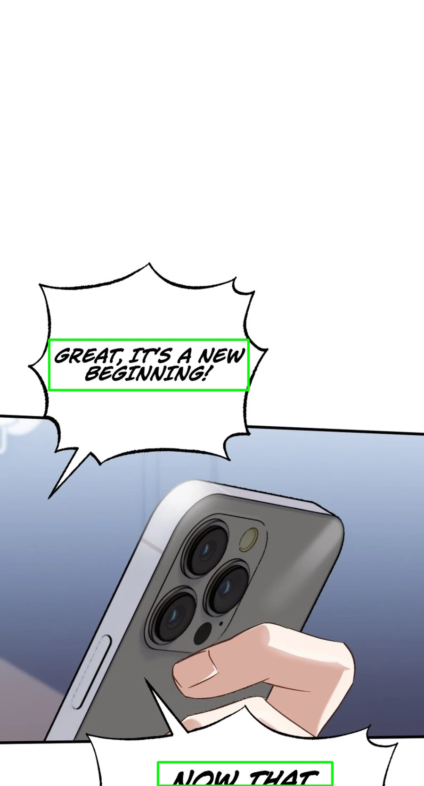

# manga-translation

[🇬🇧 English](README.md) | 🇹🇷 Türkçe

Manga/çizgi roman bölümlerini uçtan uca çeviren, kuyruk tabanlı, arayüzsüz
(headless) bir worker: ham sayfaları indir → metni tespit et → OCR yap →
balonları temizle → çevir → çevrilmiş metni render et → sonucu yükle.
GUI yok, ekransız (offscreen) metin render etmek için gerekenden başka
masaüstü bağımlılığı yok.

## Hız & maliyet

Bu serinin 67 sayfalık bir bölümünü varsayılan motorlarla (RT-DETR v4-s int8
detector, Qwen3-VL-Flash Grid OCR, GPT-5.4-mini çeviri), `BATCH_PIPELINE=true`,
3 paralel worker ile, sıradan bir CPU'da çevirirken ölçülen gerçek sayılar:

| | OCR (Qwen3-VL-Flash) | Çeviri (GPT-5.4-mini) | Toplam |
|---|---|---|---|
| Token (giriş / çıkış) | 16.234 / 1.723 | 1.629 / 2.000 | 21.586 |
| 1M token başına fiyat (giriş / çıkış) | $0.10 / $0.40 | $0.75 / $4.50 | — |
| **Bu bölümün maliyeti** | $0.0023 | $0.0102 | **~$0.0125** |

Detection ve render lokalde çalışıyor, hiçbir ücreti yok — tek harcama OCR
+ çeviri API çağrıları. Bölüm başına ~$0.0125 ile, **bu büyüklükte 1.000
bölüm çevirmek API kullanımında toplam ~$12–13** tutuyor. Bu bölümün
toplam süresi (detect → OCR → temizle → çevir → render → kaydet)
**~90–115 saniye** oldu.

Kendi sayılarınız sayfa başına diyalog yoğunluğuna ve o anki sağlayıcı
fiyatlandırmasına göre değişir. Gerçek, çağrı başına token kullanımını bir
dosyaya dökmek için `QWEN_GRID_OCR_USAGE_PATH` / `BATCH_TRANSLATE_USAGE_PATH`
ayarlayın (bkz. `.env.example`), kalıcı maliyet takibi için ise
`LOG_OPENAI_USAGE=true` ve bir `DATABASE_URL` kullanın (bkz.
[Yapılandırma](#yapılandırma)).

## Hiç bilgisi olmayanlar için adım adım kurulum

Python projesi çalıştırmayı hiç denemediysen, aşağıdakileri sırasıyla yap.

1. **Python'ı kur.** https://www.python.org/downloads/ adresine git, işletim
   sistemin için en güncel "Python 3.12" yükleyicisini indir ve çalıştır.
   Windows'ta kurulum sırasında **"Add python.exe to PATH"** kutucuğunu
   işaretlemeyi unutma.
2. **Bu projeyi indir.** GitHub'da yeşil "Code" butonuna tıkla →
   "Download ZIP", indirilen dosyayı istediğin bir yere (örn. Masaüstü)
   çıkart (unzip).
3. **O klasörde bir terminal aç.**
   - Windows: çıkarttığın klasörü Dosya Gezgini'nde aç, adres çubuğuna
     tıkla, `cmd` yaz, Enter'a bas.
   - Mac/Linux: klasöre sağ tıkla → "Open Terminal here" (veya elle `cd`
     ile o klasöre geç).
4. **Projenin bağımlılıklarını kur.** Şunu yazıp Enter'a bas:
   ```
   pip install -r requirements.txt
   ```
   Bu, projenin ihtiyaç duyduğu her şeyi indirir. Birkaç dakika sürebilir.
5. **Ayar dosyanı oluştur.** `.env.example` dosyasını kopyala ve kopyanın
   adını `.env` yap (Dosya Gezgini'nde: dosyayı kopyala/yapıştır, sonra adını
   değiştir; Mac/Linux'ta: `cp .env.example .env`).
6. **Bir çeviri API anahtarı al.** https://platform.openai.com/api-keys
   adresine git, hesabın yoksa oluştur, yeni bir API anahtarı oluştur
   (`sk-...` şeklinde görünür). `.env` dosyasını herhangi bir metin
   düzenleyiciyle aç (Notepad yeterli), `OPENAI_API_KEY=` satırını bul ve
   anahtarını `=` işaretinden hemen sonra, boşluk koymadan yapıştır, örn.
   `OPENAI_API_KEY=sk-abc123...`. Dosyayı kaydet.
   (OpenAI her çevrilen sayfa için küçük bir ücret alır — bölüm başına
   genelde birkaç cent.)
7. **Görsellerini koy.** Proje içinde bir `input` klasörü var — manga sayfa
   görsellerini (jpg/png/webp) sürükleyip bu klasöre bırak.
8. **Çalıştır.** Terminale dön, şunu yaz:
   ```
   python scripts/local_batch.py
   ```
   ve Enter'a bas. Her sayfa için ilerleme yazdırılacak
   (`detect` → `ocr` → `clean` → `translate` → `render` → `save`).
9. **Sonucunu al.** İşlem bittiğinde `output` klasörünü aç — çevrilmiş
   sayfaların orada. Tek tek dosyalar yerine hepsini bir .zip dosyası olarak
   mı istiyorsun? `.env` dosyasını aç, `ZIP_OUTPUT=false`'u `ZIP_OUTPUT=true`
   yap, kaydet, 8. adımı tekrar çalıştır — `output` klasörünün yanında bir
   `output.zip` dosyası bulacaksın.

Hepsi bu — veritabanı yok, sunucu yok, çeviri API anahtarından başka hesap
yok. Bu noktadan sonrası, daha gelişmiş kurulumlar için referans dokümandır
(hedef dili değiştirmek, sunucuda çalıştırmak, bir web sitesine entegre
etmek vb.).

İki şekilde çalışabilir:

- **CLI modu** (`scripts/local_batch.py`) — bu projeyi kullanmanın asıl,
  "her şey dahil" yolu. Görselleri `input/`'a koy, bir komut çalıştır,
  çevrilmiş görselleri `output/`'tan al. Veritabanı yok, bulut hesabı yok,
  entegrasyon işi yok. Çoğu kişinin istediği şey bu.
- **Worker modu** (`scripts/worker.py`) — bir Postgres iş kuyruğunu
  dinleyen ve sonuçları bir web sitesinin veritabanına geri yazan
  gelişmiş/opsiyonel bir mod. Orijinal yazarın production'da kullandığı
  yöntem budur, kendi sitesinin şemasına bağlıdır. **Kutudan çıkar
  çalışır** bir bileşen değildir — kullanmadan önce
  [Worker modu / veritabanı entegrasyonu](#worker-modu--veritabanı-entegrasyonu)
  bölümüne bak.

Depolama ve marka bilgileri koda gömülü değil, ortam değişkenlerinden (env)
okunuyor — yani aynı kod herhangi bir site adı, hedef dil, font veya
depolama backend'i için çalışır.

## Pipeline aşamaları

```
ham sayfalar (R2 bucket veya yerel disk)
        │  indir
        ▼
 [1] detect       — metin/balon bölgelerini bul (RT-DETR ONNX)
        ▼
 [2] ocr          — her bölgedeki metni oku
        ▼
 [3] clean         — kaynak metni sil, balonu inpaint/temizle
        ▼
 [4] translate     — her metin bloğunu çevir (GPT, Gemini, vb.)
        ▼
 [5] render        — çevrilmiş metni sayfaya geri çiz
        ▼
 [6] save          — çevrilmiş görseli yaz (webp/png/jpg)
        │  yükle
        ▼
çevrilmiş sayfalar (R2 bucket veya yerel disk)
        │
        ▼ (sadece worker modu)
   chapter_assets / sayfa satırları + SEO alt metni DATABASE_URL'e yazılır
```

## Her aşama gerçekte ne işe yarıyor

"detect → ocr → clean → translate → render" pratikte ne anlama geliyor,
hâlâ tam anlamadın mı? İşte aynı sayfa, her adımda fotoğraflanmış. (Örnek
sayfa İngilizce; buradaki hedef dil Türkçe — seninki `TARGET_LANG` ile
istediğin dil olabilir.)

| | |
|---|---|
| <br>**1. Ham sayfa** — `input/`'a tam olarak koyduğun şey. Dokunulmamış. | <br>**2. Detect** — model her konuşma balonunu/metin alanını bulur (yeşil kutular). Metnin ne dediğini henüz bilmiyor, sadece *nerede* olduğunu biliyor. |
| <br>**3. OCR** — kutulanan her alan okunur. Her kutunun üstündeki turuncu metin OCR motorunun ne yazdığını düşündüğü şeydir (burada: "GREAT, IT'S A NEW BEGINN...", "NOW THAT"). | <br>**4. Clean** — orijinal İngilizce metin silinir ve balon, yeni metin için hazır şekilde düz bir arka plana yamanır. |
| <br>**5. Translate + render** — OCR'lanan metin çevrilir ("Great, it's a new beginning!" → "Harika, yeni bir başlangıç!") ve boyut/konumu eşleştirilerek temizlenmiş balona geri çizilir. | Bu, `output/`'a düşen görseldir. 4. ve 5. adımlar o kadar hızlı olur ki normal kullanımda yalnızca ham sayfayı ve son sonucu görürsün — buradaki ara kareler sadece pipeline'ın perde arkasında ne yaptığını göstermek için var. |

## Gereksinimler

- Python 3.12
- Seçtiğin çevirmen/OCR motoru için bir API anahtarı (örn. GPT için
  `OPENAI_API_KEY`, Qwen için `DASHSCOPE_API_KEY`)
- Opsiyonel: tamamen yerel çalışmıyorsan Cloudflare R2 (veya herhangi bir
  S3-uyumlu) bucket
- Sadece worker modu için: [Worker modu / veritabanı entegrasyonu](#worker-modu--veritabanı-entegrasyonu)
  bölümünde açıklanan şemaya uyan bir Postgres veritabanı

Model ağırlıkları (detector, OCR, inpainting) ilk kullanımda kendi public
host'larından otomatik indirilir — elle indirilecek bir şey yok.

## Hızlı başlangıç (PC / yerel kullanım, veritabanı yok)

Bu, projeyi kullanmanın en kolay yolu — bulut hesabı yok, veritabanı yok.

```bash
pip install -r requirements.txt
cp .env.example .env   # en azından OPENAI_API_KEY'i doldur
```

Ham sayfa görsellerini `input/` klasörüne koy (repoda hazır olarak boş
şekilde duruyor), sonra çalıştır:

```bash
python scripts/local_batch.py
```

Varsayılan olarak bu, `input/`'taki her şeyi okur, `.env` ayarlarına göre
çevirir ve çevrilmiş sayfaları `output/`'a yazar. `--input`/`--output` ile
farklı klasörler gösterebilir, veya çalışma bitince çıktı klasörünün yanına
bir `output.zip` da üretmesi için `--zip-output` geçebilirsin (veya
`.env`'de `ZIP_OUTPUT=true` ayarlayabilirsin) — tek bir dosya almak/paylaşmak
istiyorsan kullanışlı.

Aynı `output/` klasörüyle tekrar çalıştırmak, zaten çevrilmiş sayfaları
atlar, yani büyük bir partiyi güvenle durdurup devam ettirebilirsin.

## Worker modu / veritabanı entegrasyonu

`scripts/worker.py`, boş bir veritabanına karşı olduğu gibi çalıştırılmak
için **tasarlanmamıştır** — bu, orijinal yazarın production'da, kendi
sitesinin mevcut `Manga`/`Chapter` tablolarına bağlı şekilde kullandığı
gerçek koddur. Bunu kutudan çıkar çalışır bir bileşen değil, uyarlanması
gereken bir referans implementasyon olarak düşün.

**Önemli: worker kendi başına iş (job) oluşturmaz.** Sadece bir kuyruk
tablosunu *dinler* (poll) ve içinde `status = 'QUEUED'` olarak duran her
şeyi işler. Başka bir şey — senin kendi sitenin/admin panelinin — o kuyruğa
bir satır `INSERT` etmesi gerekir (örn. bir admin yeni bir ham bölüm
yüklediği an). Bu kısmı bağlamak sana kalıyor; yeterince basit ki bir AI
kodlama asistanı (Claude, GPT, vb.) bu bölümü ve `scripts/worker.py`'yi
bağlam olarak verdiğinde senin için yazabilir — sadece bu dosyayı ve
aşağıdaki tablo listesini göster, kendi backend'in/admin panelin için
gereken migration + "iş oluştur" kodunu üretmesini iste.

### Kuyruk döngüsü gerçekte nasıl çalışıyor

Her `WORKER_IDLE_SECONDS`'da (varsayılan 15sn), worker:

1. `pipeline_jobs`'tan `priority` sonra `created_at`'e göre sıralı bir
   `QUEUED` satır alır (`FOR UPDATE SKIP LOCKED` ile, yani aynı kuyruğa
   karşı birden fazla worker process'i güvenle çalıştırabilirsin, bir işi
   iki kez işlemez).
2. `job_type`'a bakar ve şunlardan birini yapar:
   - `TRANSLATE_PROJECT` — bir manga için çevrilmemiş her bölümü bulur ve
     işi her bölüm için bir `TRANSLATE_CHAPTER` job'ına böler (böylece
     birden fazla worker bunları paralel olarak alabilir), sonra çıkar.
   - `TRANSLATE_CHAPTER` / `RETRANSLATE_CHAPTER` — tek bir bölümü çevirir:
     bölüm/manga satırına bakar, ham görsellerin R2 prefix'ini bulur,
     yukarıdaki Senaryo A ile tamamen aynı şekilde `local_batch.py`'yi
     çalıştırır, sonra sonuçları veritabanına geri yazar (aşağıya bak).
   - `CLEANUP_RAW_CHAPTER` — artık ihtiyacın olmadığında bir bölümün ham
     (çevrilmemiş) görsellerini R2'den siler.
3. İşi `DONE` veya `FAILED` (bir `error_message` ile) olarak işaretler,
   ya da çalışırken senin uygulaman durumunu `CANCEL_REQUESTED` yaptıysa
   `CANCELLED` yapar.

Arka planda çalışan bir tick ayrıca 20 dakikadan fazla `RUNNING`'de kalmış
işleri temizler (çökmüş worker), eskimiş `CANCEL_REQUESTED` satırlarını
sonlandırır ve birkaç gün sonra bitmiş işleri siler — böylece kuyruk
tablosu sonsuza kadar büyümez.

### Bitmiş bir bölüm çevirisi neyi geri yazar

Bir bölümün sayfaları çevrilip R2'ye yüklendiğinde, worker:

- Her sayfa için bir `chapter_assets` satırı ekler (`asset_type =
  'TRANSLATED'`), R2 object key, public URL ve boyut bilgisiyle.
- Her sayfa için, görsel URL'si ile birlikte `SEO_TITLE_TEMPLATE`'ten
  üretilen SEO `altText`/`titleText`'i içeren bir `"ChapterPage"` satırı
  ekler (bkz. [Marka ve SEO](#marka-ve-seo-tamamen-değiştirilebilir)).
- `"Chapter"."publishStatus"` ve `"Manga"."publishStatus"`'u `PUBLISHED`
  yapar, `"Manga"."latestChapterNo"`'yu artırır.
- Bölüm/manga çeviri sonrası otomatik silmeye ayarlıysa, ham asset'leri
  opsiyonel olarak siler.
- Frontend'inin o manga için cache'ini geçersiz kılabilmesi için opsiyonel
  olarak bir webhook çağırır (`WEB_INTERNAL_URL` + `INTERNAL_API_KEY`).

### İhtiyacın olan tablolar

| Tablo | Amaç | `worker.py`'nin okuduğu/yazdığı anahtar kolonlar |
|---|---|---|
| `pipeline_jobs` | Kuyruğun kendisi | `id`, `manga_id`, `chapter_id`, `job_type` (`TRANSLATE_PROJECT`/`TRANSLATE_CHAPTER`/`RETRANSLATE_CHAPTER`/`CLEANUP_RAW_CHAPTER`), `status` (`QUEUED`/`RUNNING`/`DONE`/`FAILED`/`CANCEL_REQUESTED`/`CANCELLED`), `priority`, `payload` (jsonb), `progress`, `error_message`, `created_at`, `updated_at`, `started_at`, `finished_at` |
| `"Manga"` / `"Chapter"` | Senin mevcut içerik tabloların | manga: `id`, `slug`, `publishStatus`, `publishedAt`, `latestChapterNo`; chapter: `id`, `mangaId`, `number`, `slug`, `publishStatus`, `publishedAt` |
| `chapter_assets` | Bölüm başına yüklenen görsel partilerini takip eder | `id`, `chapter_id`, `page_index`, `asset_type` (`RAW`/`TRANSLATED`), `storage_provider`, `bucket`, `object_key`, `public_url`, `mime_type`, `size_bytes` |
| `"ChapterPage"` | Frontend'inin bir bölümü render etmek için okuduğu sayfa başına satırlar | `id`, `"chapterId"`, `"pageIndex"`, `"imageUrl"`, `"altText"`, `"titleText"`, `"r2Key"` |
| `worker_heartbeats` | Bir worker process'inin canlı olduğunu izlemeni sağlar | `worker_id`, `last_seen_at`, `jobs_processed` |
| `project_automations` (opsiyonel) | Manga başına otomasyon ayarları | `manga_id`, `auto_delete_raw_after_translate` — bu tablo/satır yoksa, worker varsayılan olarak çeviri sonrası ham asset'leri siler |

`scripts/worker.py`'yi baştan sona oku — her SQL ifadesi beklediği kolonları
tam olarak adlandırır — ve `DATABASE_URL`'i gerçek bir veritabanına
yönlendirmeden önce sorguları kendi şemana uyacak şekilde ayarla. Senin
hâlâ kendin inşa etmen gereken parça, bir şeyi gerçekten çevirmek
istediğinde `pipeline_jobs`'a `TRANSLATE_CHAPTER`/`TRANSLATE_PROJECT`
satırları ekleyen kod.

```bash
pip install -r requirements.txt
cp .env.example .env   # DATABASE_URL, storage backend vb. doldur

python scripts/worker.py
```

### Docker

```bash
docker build -t manga-translation .
docker run --env-file .env manga-translation
```

İmaj Qt'yi offscreen modda çalıştırır (`QT_QPA_PLATFORM=offscreen`), yani
bir display server'a gerek yoktur.

## Yapılandırma

Tüm yapılandırma ortam değişkenlerinde yaşar — varsayılanlar ve yorumlarla
birlikte tam listeyi `.env.example`'da bul. Ana gruplar:

| Grup | Değişkenler |
|---|---|
| Veritabanı | `DATABASE_URL` |
| Depolama backend'i | `STORAGE_BACKEND` (`r2` veya `local`), `LOCAL_STORAGE_ROOT`, `R2_*` |
| Marka / SEO | `SEO_SITE_NAME`, `SEO_LANGUAGE_PHRASE`, `SEO_TITLE_TEMPLATE`, `SEO_IMAGE_BRAND`, `SEO_FILENAME_LANGUAGE_SLUG`, `SEO_FILENAME_TEMPLATE` |
| Diller | `SOURCE_LANG`, `TARGET_LANG` |
| Motor seçimi | `DETECTOR`, `OCR`, `TRANSLATOR`, `OPENAI_API_KEY`, `OPENAI_MODEL` |
| Font / render | `FONT_FAMILY`, `FONT_FILE`, `MIN_FONT_SIZE`, `MAX_FONT_SIZE`, `UPPERCASE`, `NO_OUTLINE` |
| Çıktı | `OUTPUT_SUFFIX`, `OUTPUT_FORMAT`, `WEBP_MAX_DIMENSION` |
| Temizleme ayarları | `BUBBLE_*`, `LIGHT_*`, `CROP_CLEAN_*`, `PANEL_SKIP_*` heuristikleri |

### Marka ve SEO tamamen değiştirilebilir

Veritabanına yazılan alt-text ve yüklenen görsel dosya adlarının ikisi de
koda gömülü string'ler değil, şablonlardan üretilir:

- `worker.py`'deki `seo_alt()`, `SEO_TITLE_TEMPLATE`'i `{site_name}`,
  `{language_phrase}`, `{slug}`, `{number}`, `{page}` ile formatlar.
- `local_batch.py`'deki `seo_upload_name()`, `SEO_FILENAME_TEMPLATE`'i
  `{brand}`, `{language_slug}`, `{series}`, `{chapter}`, `{page}`, `{ext}`
  ile formatlar.

Başka bir site veya dil için kod dokunmadan rebrand etmek için
`SEO_SITE_NAME`/`SEO_LANGUAGE_PHRASE`/`SEO_IMAGE_BRAND`'i (veya şablonların
kendisini) değiştir.

### Depolama backend'leri

- `STORAGE_BACKEND=r2` (varsayılan): `R2_*` değişkenleriyle yapılandırılan
  Cloudflare R2 veya herhangi bir S3-uyumlu bucket üzerinden okur/yazar.
  Worker modu için bu zorunludur, çünkü worker veritabanına yazmak için
  public URL'lere ihtiyaç duyar.
- `STORAGE_BACKEND=local`: `LOCAL_STORAGE_ROOT` altındaki düz dosyaları
  okur/yazar. Tamamen offline çalıştırmalar için `local_batch.py` ile
  çalışır; `worker.py`'nin veritabanı geri yazma yolunda kullanılmaz.

### Fontlar

`assets/Comic Geek.ttf`'te bir font gömülü olarak gelir ve varsayılan
olarak kullanılır (`.env.example`'da `FONT_FILE`). Farklı bir görünüm için
kendi `.ttf`/`.otf` dosyanı koy, veya `FONT_FILE`'ı temizleyip
`FONT_FAMILY`'i host/container'da zaten kurulu bir fonta ayarla. Offscreen
Qt'nin gerçek bir sistem fontu fallback'i yok, yani `FONT_FILE`'ı kullanılır
bir `FONT_FAMILY` kurulu olmadan boş bırakmak, ASCII olmayan metni eksik
glif kutuları olarak render eder.


#### Fontları yerleştirme

Stile duyarlı renderer'ın kullandığı ek çizgi roman fontları, yeniden dağıtım lisansları bilinmediği için commit edilmez (`FONT KLASÖR/` git tarafından yok sayılır). Kendi `.ttf`/`.otf` dosyalarınızı proje kökündeki `FONT KLASÖR/` klasörüne koyun; yoksa renderer `assets/Comic Geek.ttf` dosyasına veya sistem fontuna düşer.

## GPU

CUDA varsa GPU **varsayılan olarak açıktır**, yoksa CPU'ya düşülür (`USE_GPU=auto`). RT-DETR dedektörünü (`USE_GPU` / `--gpu` / `--no-gpu`), YOLO metin segmenter'ı ve LaMa inpainting'i (`SEG_DEVICE` / `LAMA_DEVICE`, `auto|cuda|cpu`, varsayılan `auto`) kapsar. `USE_GPU=false` veya `--no-gpu` her şeyi CPU'ya alır (`SEG_DEVICE`/`LAMA_DEVICE` açıkça verilmedikçe); `USE_GPU=true` zorla açar, CUDA yoksa yine CPU'ya düşer. OCR ve çeviri uzak API çağrılarıdır, yerel GPU kullanmaz. `requirements.txt` CPU tabanıdır. Bir venv'i GPU'ya geçirmek için:

```
pip uninstall -y onnxruntime torch torchvision
pip install -r requirements-gpu.txt
```

Bu komut torch/torchvision'ın CUDA 13 sürümlerini ve `onnxruntime-gpu`'yu kurar (CUDA 13 destekli NVIDIA sürücüsü gerekir). `onnxruntime` ile `onnxruntime-gpu` aynı anda kurulu kalmamalı. GPU kullanıldığında günlükte `[BATCH] detector device: cuda`, `[clean] segmenter device: cuda` ve `[clean] LaMa device: cuda` satırları görünür. TensorRT sağlayıcısı `USE_TENSORRT=true` verilmedikçe kullanılmaz.

## Varsayılanlar

`local_batch.py` ve worker varsayılan olarak şunlarla çalışır:

| Ayar | Varsayılan | Not |
|---|---|---|
| `USE_GPU` | `auto` | CUDA varsa GPU, yoksa CPU; kapatmak için `--no-gpu` |
| `OUTPUT_FORMAT` | `webp` | kalite `IMAGE_QUALITY=95`; worker her zaman webp yükler |
| `OUTPUT_SUFFIX` | `_translated` | boş olabilir: `--suffix=` veya `OUTPUT_SUFFIX=` (bazı kabuklar çıplak `--suffix ""` değerini düşürür) |
| `BATCH_PIPELINE` | `true` | 3 aşamalı toplu işlem |
| `BATCH_WORKERS` | `3` | detect+OCR ve temizleme aşamaları için thread havuzu tabanı |
| `BATCH_WORKERS_AUTO` / `BATCH_WORKERS_MAX` | `true` / `4` | auto açıkken CPU boşta (<%35) ise taban +1, meşgulse (>%80) -1 olur, `BATCH_WORKERS_MAX` değerini aşmaz; günlükte `[CPU n%] worker: 3 -> 4` görünür. Tam `BATCH_WORKERS` için `BATCH_WORKERS_AUTO=false` |
| `BATCH_TRANSLATE_CONCURRENCY` | `3` | paralel GPT çeviri çağrısı (her çağrı 3 sayfa); `1` = sıralı; gateway devre kesici açıkken 1'e düşer |
| `OCR_CONCURRENCY` | `2` | aynı anda uçuşta olabilecek OCR isteği sayısı (`BATCH_WORKERS`'tan bağımsız) |
| `GATEWAY_BACKOFFS` | `3,8,20` | OCR, çeviri ve vision çağrılarında 5xx/429/zaman aşımı için bekleme süreleri (sn, jitter'lı); art arda 3 hata 20 sn -> 60 sn ortak bekleme açar |
| `OCR_MAX_FAIL_RATIO` | `0.0` | OCR/çeviri hatası verebilecek sayfa oranı; aşılırsa iş yayınlanmadan 3 koduyla düşer (`FAILED: OCR failed on N pages`), ham sayfalar silinmez, iş yeniden denenir |
| `PASSTHROUGH_SUSPECT_RATIO` | `0.5` | metin balonu tespit edilen sayfaların bundan fazlası 0 bloklu (OCR boş) bitiyorsa iş hata verir |
| `WATERMARK_POLICY` | `clean` | `clean` rakip watermark/banner'ları bütün olarak siler (kendi markamıza dokunmaz); `keep` dokunmaz |
| `RENDER_V2`, `RENDER_STYLE_TAGS` | `true` | balon ve stile duyarlı dizgi |
| `RENDER_BALLOON_UNIFY` | `true` | aynı balondaki bloklar tek font ve tek boyut bandı kullanır (`RENDER_BALLOON_BAND`, varsayılan `0.12`; kaynak harf yüksekliği `RENDER_EMPHASIS_RATIO` (1.4) oranından fazla farklıysa vurgu sayılır) ve her satır balon içinde kalır; `false` = eski blok bazlı boyut |
| `RENDER_MERGE_BALLOON` | `true` | OCR'ın bir balonda birkaç bloğa böldüğü tek cümle tek paragraf olarak dizilir; blok sınırında tekrar eden kelimeler atılır |
| `RENDER_DEDUPE_TRANSLATIONS` | `true` | aynı balonda / üst üste binen ve çevirisi daha uzun komşunun alt metni olan blok tekrar çizilmez; art arda tekrar eden ifadeler tek kopyaya iner |
| `RENDER_GROUP_ROBUST` | `true` | toleranslı balon gruplama (farklı boyutlu balon kutuları, iç içe metin kutuları aynı balon sayılır) |
| `RENDER_ABSORB_STRAYS` | `true` | balon içindeki küçük 1-2 kelimelik başıboş blok balonun ana metnine katılır |
| `RENDER_MERGE_NARRATION` | `true` | üst üste dizili anlatım/altyazı satırları tek paragraf olur |
| `RENDER_HARD_GUARD` | `true` | her balon bloğunun tüm satırları (+%2 boşluk) balon içinde kalır; gerekirse blok küçülür |
| `BLOCK_CONTAINMENT_PRUNE`, `BLOCK_CONTAINMENT_RATIO`, `BLOCK_TEXT_COVER` | `true`, `0.6`, `0.8` | çeviriden önce: başka bir bloğun içinde (>= %60) duran ve kelimeleri (>= %80) o bloğta zaten bulunan blok atılır |
| `RENDER_RESOLVE_OVERLAP` | `true` | üst üste binen yazı kutuları ayrılır / küçültülür |

Herhangi birini değiştirmek için aynı adlı ortam değişkenini ayarlayın, örneğin `BATCH_PIPELINE=false`.

## OCR öncesi güvenli bölüm kesimi

`WEBTOON_SAFE_RECUT=true` varsayılan olarak açıktır. Worker, her yeni bölümün
ham görsellerini sanal bir dikey şerit olarak okur; dev bir birleşik görüntüyü
bellekte tutmaz. 1600 piksel yüksekliğinde, 600 piksel örtüşen pencerelerde
metin ve balon kutuları bulunur. Kutuların çevresine 24 piksel pay eklenir;
tam genişlikte en az 24 piksel yüksekliğindeki düz renkli boşluklardan kesilir.
Boş bir balonun içinden kesmemek için metinsiz balon kutuları da korunur.

Yeni, kayıpsız PNG parçaları OCR, çeviri, temizleme ve yazma aşamalarına gider.
Yayımlanan sayfalar bu yeni kesimleri kullanır; mevcut reklam kırpma/çıkarma,
damga ve SEO dosya adları aynı işlem akışında devam eder. Sayfa sayısı değişebilir.
Önceki kesimlerin çeviri önbelleği yeniden kullanılmaz. Kaynak dosyalar değişmez.
Kesilmiş parçaların piksel karması kaynak şeritle doğrulanır.

`RECUT_TARGET_HEIGHT=2000` hedef parça yüksekliğidir. 3600 piksel yumuşak sınırdır;
güvenli boşluk için biraz aşılabilir. `RECUT_MAX_HEIGHT=8000` sert sınırdır
(en fazla 16000). Güvenli kesim bulunamazsa işlem hata verir; R2 yükleme ve ham
görsellerin silinmesi yapılmaz. Algılayıcı tahminleri kusursuz değildir; özellikle
alışılmadık bölüm düzenlerinde sonuçların kontrol edilmesi gerekir. Farklı
genişlikteki kaynaklar otomatik olarak gerilmez; hata verir.

Manuel eski akış için `--no-safe-recut` veya `WEBTOON_SAFE_RECUT=false` kullanılabilir.
Özellik mevcut yayımlanmış bölümleri otomatik yeniden çevirmez; sonraki çeviri
işlerinde çalışır. Yerel denemeler ve R2 worker işleri aynı ön işlemden geçer.

```powershell
& .venv/Scripts/python.exe -m unittest discover -s tests -p test_safe_recut.py
```

## Lisans

`LICENSE`'a bak.


## GPU olmayan sunucu / Docker

CPU sunucu kurulumu, örnek environment ve çalıştırma komutları: [DEPLOY.cpu.md](DEPLOY.cpu.md).
